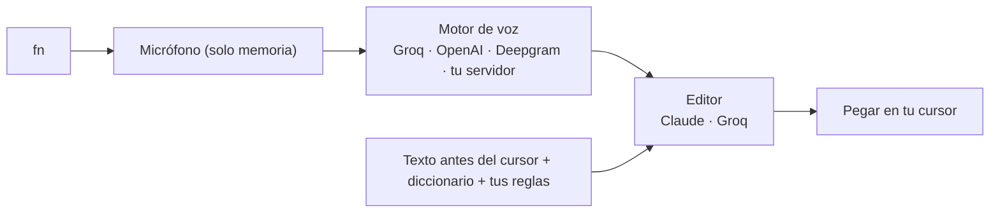

<div align="center">


# Bruma

**Habla. Bruma escribe.**

Teclado por voz gratuito y de código abierto para tu Mac. Toca <kbd>fn</kbd>, habla, y el texto aparece limpio y bien puntuado donde está tu cursor, en cualquier app.

[](LICENSE)
[](#instalación)
[](#instalación)
[](https://github.com/yairhdz24/bruma/releases)
[](https://github.com/yairhdz24/bruma/stargazers)

[**Descargar**](https://github.com/yairhdz24/bruma/releases/latest) · [English](README.md) · [Cómo funciona](docs/ARCHITECTURE.md) · [Reportar un problema](https://github.com/yairhdz24/bruma/issues/new/choose)


</div>


## Por qué Bruma

- **Gratis para uso personal.** Usas tu propia clave. Con el plan gratuito de Groq puedes dictar horas al día sin pagar nada. Sin suscripción, sin cuenta y sin servidor de Bruma.
- **Privada por diseño.** Tu audio vive en memoria y va directo de tu Mac al motor que tú elijas. Las claves solo existen en tu computadora.
- **Se siente nativa.** Una píldora pequeña sobre el Dock que se tiñe del color de la app donde escribes, ventanas de vidrio líquido, tipografía San Francisco y los botones reales de macOS.
- **Escribe como tú.** Quita muletillas y titubeos, aplica autocorrecciones ("el martes, no, el viernes" → "el viernes"), puntúa bien en español (¿? ¡!), respeta las palabras que dices en inglés y se adapta a cada app: breve en WhatsApp, en párrafos en Correo y exacta en tu editor de código.

## Funciones

| | |
| --- | --- |
| 🎙️ **fn para hablar** | Toca <kbd>fn</kbd> para empezar y otra vez para pegar, o mantenla y suéltala. También fn + Espacio o cualquier atajo. <kbd>Esc</kbd> cancela en cualquier app. |
| ⚡ **Palabras en vivo** | Con Deepgram Nova-3 las palabras aparecen sobre la píldora mientras hablas. |
| 🧠 **Entiende el contexto** | Lee las últimas palabras antes del cursor para acertar con espacios y mayúsculas (nunca en campos de contraseña). |
| 📚 **Aprende tus palabras** | Si corriges una palabra después de pegar, la píldora te ofrece guardarla en tu diccionario. |
| ✍️ **Tus reglas** | Instrucciones fijas en lenguaje normal: "tutea siempre", "firma los correos como Ana", "nada de emojis". |
| 🗣️ **Atajos de voz** | Di "mi correo" y se escribe tu dirección. |
| 🌎 **Idiomas mezclados** | Mezcla español e inglés en la misma frase; no se traduce nada si no lo pides. |
| 🔌 **Cualquier motor y modelo** | Groq, OpenAI, Deepgram o tu propio servidor Whisper, con todos los modelos de cada servicio. Claude o Groq para pulir. |
| 📈 **Tus estadísticas** | Palabras, palabras por minuto, tiempo ahorrado y racha, todo local. |

<table>
<tr>
<td></td>
<td></td>
</tr>
</table>

## Instalación

### macOS (Apple Silicon, macOS 12 o superior)

**Con una línea** (descarga la última versión y la firma en tu Mac para que macOS conserve tus permisos en cada actualización):

```sh
curl -fsSL https://raw.githubusercontent.com/yairhdz24/bruma/main/scripts/install-mac.sh | zsh
```

**O a mano:** descarga `Bruma-…-macOS-Apple-Silicon.dmg` desde [Releases](https://github.com/yairhdz24/bruma/releases/latest) y arrastra Bruma a Aplicaciones. Bruma todavía no está notarizada por Apple, así que la primera vez haz clic derecho en la app → **Abrir** (o ejecuta `xattr -dr com.apple.quarantine /Applications/Bruma.app`).

### Windows (beta)

Descarga `Bruma-…-Windows-x64-setup.exe` desde [Releases](https://github.com/yairhdz24/bruma/releases/latest). Si aparece SmartScreen, elige **Más información → Ejecutar de todas formas**. Usa un atajo como <kbd>Ctrl</kbd>+<kbd>Espacio</kbd> (la tecla fn solo funciona en macOS).

## Configúrala en dos minutos

1. **Permisos.** La bienvenida te pide **Micrófono** (para escucharte) y **Accesibilidad** (para pegar y leer la tecla fn).
2. **Consigue una clave gratis.** Créala en [console.groq.com/keys](https://console.groq.com/keys) (no pide tarjeta) y pégala en **Conexiones**.
3. **Opcional:** agrega una clave de Claude, OpenAI o Deepgram para un pulido todavía mejor o palabras en vivo.
4. En macOS, ve a **Ajustes del Sistema → Teclado → "Al presionar 🌐: No hacer nada"** para que fn quede libre para Bruma.

Listo. Pon el cursor donde quieras, toca <kbd>fn</kbd> y habla.

## Cómo funciona



Bruma es una app de [Tauri 2](https://tauri.app): interfaz en React + TypeScript sobre un núcleo en Rust, más unos pocos módulos en Objective-C para la tecla fn, el pegado y Accesibilidad. Los detalles están en [docs/ARCHITECTURE.md](docs/ARCHITECTURE.md).

## Cuánto cuesta

| Motor | Precio | Notas |
| --- | --- | --- |
| **Groq** Whisper Large v3 Turbo | **Plan gratis**, unas 8 h de audio al día | Por defecto. Muy rápido. |
| **Groq** para pulir | **Plan gratis** | GPT-OSS 120B; si falla, Llama 3.3. |
| Claude Haiku para pulir | Fracciones de centavo por dictado | La mejor redacción. Usa tus créditos de la API de Anthropic. |
| Deepgram Nova-3 | US$200 de crédito inicial, después ~US$0.46/h | Palabras en vivo mientras hablas. |
| OpenAI | Pago por uso | Modelos GPT-4o Transcribe. |
| Tu propio servidor | Tu hardware | Cualquier Whisper compatible con OpenAI, por ejemplo [Speaches](https://github.com/speaches-ai/speaches). |

Los precios los fija cada proveedor y pueden cambiar; revisa sus sitios.

## Privacidad y seguridad

- **Sin servidor de Bruma, sin telemetría y sin cuenta.**
- **Tus claves nunca salen de tu computadora.** En macOS van en un archivo privado que solo tu usuario puede leer (`credentials.json`, permisos 0600); en Windows, en el Administrador de credenciales. La interfaz nunca las ve.
- **El audio nunca se guarda.** Vive en memoria y solo se envía al motor que elegiste.
- **El historial es local** y puedes desactivarlo o borrarlo.
- **Nunca envía por ti.** Bruma pega, nunca presiona Enter, y después restaura tu portapapeles.

Para reportar una vulnerabilidad de forma privada, consulta [SECURITY.md](SECURITY.md).

## Compilar desde el código

```sh
git clone https://github.com/yairhdz24/bruma && cd bruma
npm ci
npm run dev          # vista previa de la interfaz en el navegador (modo demostración)
npm run tauri dev    # app de escritorio completa (requiere Rust y los requisitos de Tauri)
npm test             # Playwright
cd src-tauri && cargo test
```

## Lo que viene

- [ ] Editar con la voz: selecciona un texto y di "hazlo formal" o "tradúcelo al inglés".
- [ ] Modo prompt: convierte lo que hablas en un prompt bien estructurado para apps de IA.
- [ ] Palabras en vivo con motores gratuitos (Whisper por fragmentos).
- [ ] Whisper local (WhisperKit / whisper.cpp) para dictar sin internet.
- [ ] Versiones de macOS notarizadas y una versión para Intel.

Las ideas y los pull requests son bienvenidos; empieza por [CONTRIBUTING.md](CONTRIBUTING.md).

## Historial de estrellas

Si Bruma te ahorra tiempo, una ⭐ ayuda muchísimo: así la encuentran otras personas.

[](https://star-history.com/#yairhdz24/bruma&Date)

## Créditos

Creada por **[Yair Hernández](https://github.com/yairhdz24)**. Los logos de servicios vienen de [svgl](https://svgl.app) y pertenecen a sus dueños; consulta [docs/brand-assets.md](docs/brand-assets.md).

Publicada con la [licencia MIT](LICENSE).
