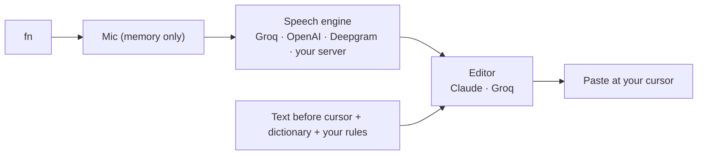

<div align="center">


# Bruma

**Talk. Bruma types.**

Free, open-source voice keyboard for your Mac. Tap <kbd>fn</kbd>, speak, and clean, punctuated text appears wherever your cursor is: in any app.

[](LICENSE)
[](#install)
[](#install)
[](https://github.com/yairhdz24/bruma/releases)
[](https://github.com/yairhdz24/bruma/stargazers)

[**Download**](https://github.com/yairhdz24/bruma/releases/latest) · [Español](README.es.md) · [How it works](docs/ARCHITECTURE.md) · [Report a bug](https://github.com/yairhdz24/bruma/issues/new/choose)


</div>


## Why Bruma

- **Free for personal use.** Bring your own key. With Groq's free tier you can dictate for hours a day without paying anything. No subscription, no account, no Bruma server.
- **Private by design.** Your audio stays in memory and goes straight from your Mac to the engine *you* choose. Keys live only on your computer.
- **Feels native.** A tiny pill above the Dock that wears the color of the app you're writing into, liquid-glass windows, San Francisco type, and real macOS traffic lights.
- **Writes like you.** Removes "um" and false starts, applies self-corrections ("Tuesday, no, Friday" → "Friday"), punctuates Spanish properly (¿? ¡!), keeps English words in English, and adapts to the app: short in WhatsApp, paragraphs in Mail, exact in your code editor.

## Features

| | |
| --- | --- |
| 🎙️ **fn to talk** | Tap <kbd>fn</kbd> to start and again to paste, or hold it and let go. Also fn + Space or any shortcut. <kbd>Esc</kbd> cancels anywhere. |
| ⚡ **Live words** | With Deepgram Nova-3, words fade in above the pill while you speak. |
| 🧠 **Context-aware** | Reads the few words before your cursor to get spaces and capitals right (never password fields). |
| 📚 **Learns your words** | Fix a word after Bruma pastes and the pill offers to add it to your dictionary. |
| ✍️ **Your rules** | Standing instructions in plain language: "always informal", "sign emails as Ana", "no emojis". |
| 🗣️ **Voice shortcuts** | Say "my email" and your address is typed. |
| 🌎 **Mixed languages** | Speak Spanish and English in the same sentence; nothing gets translated unless you ask. |
| 🔌 **Any engine, any model** | Groq, OpenAI, Deepgram or your own Whisper server, with every model each service offers. Claude or Groq to polish. |
| 📈 **Your stats** | Words, words per minute, time saved and streak, all local. |

<table>
<tr>
<td></td>
<td></td>
</tr>
</table>

## Install

### macOS (Apple Silicon, macOS 12+)

**One line** (downloads the latest release and signs it locally so macOS keeps your permissions across updates):

```sh
curl -fsSL https://raw.githubusercontent.com/yairhdz24/bruma/main/scripts/install-mac.sh | zsh
```

**Or by hand:** download `Bruma-…-macOS-Apple-Silicon.dmg` from [Releases](https://github.com/yairhdz24/bruma/releases/latest) and drag Bruma to Applications. Bruma isn't notarized by Apple yet, so the first time right-click the app → **Open** (or run `xattr -dr com.apple.quarantine /Applications/Bruma.app`).

### Windows (beta)

Download `Bruma-…-Windows-x64-setup.exe` from [Releases](https://github.com/yairhdz24/bruma/releases/latest). If SmartScreen appears, choose **More info → Run anyway**. Use a shortcut such as <kbd>Ctrl</kbd>+<kbd>Space</kbd> (the fn key is macOS-only).

## Set up in two minutes

1. **Permissions.** The welcome tour asks for **Microphone** (to hear you) and **Accessibility** (to paste and read the fn key).
2. **Get a free key.** Create one at [console.groq.com/keys](https://console.groq.com/keys) (no card needed) and paste it in **Conexiones**.
3. **Optional:** add a Claude, OpenAI or Deepgram key for even better polishing or live words.
4. On macOS, set **System Settings → Keyboard → "Press 🌐 key to: Do Nothing"** so fn is free for Bruma.

That's it. Put your cursor anywhere, tap <kbd>fn</kbd> and talk.

## How it works



Bruma is a [Tauri 2](https://tauri.app) app: a React + TypeScript interface on top of a Rust core, plus a few small Objective-C helpers for the fn key, pasting and Accessibility. Details in [docs/ARCHITECTURE.md](docs/ARCHITECTURE.md).

## What it costs

| Engine | Price | Notes |
| --- | --- | --- |
| **Groq** Whisper Large v3 Turbo | **Free tier**, ~8 h of audio per day | Default. Very fast. |
| **Groq** to polish | **Free tier** | GPT-OSS 120B, falls back to Llama 3.3. |
| Claude Haiku to polish | Fractions of a cent per dictation | Best writing. Uses your Anthropic API credits. |
| Deepgram Nova-3 | US$200 starting credit, then ~US$0.46/h | Live words while you speak. |
| OpenAI | Pay as you go | GPT-4o Transcribe models. |
| Your own server | Your hardware | Any OpenAI-compatible Whisper, e.g. [Speaches](https://github.com/speaches-ai/speaches). |

Prices are set by each provider and can change; check their sites.

## Privacy & security

- **No Bruma server, no telemetry, no account.**
- **Keys never leave your computer.** macOS: a private file readable only by your user (`credentials.json`, mode 0600). Windows: Credential Manager. The interface never sees them.
- **Audio is never saved.** It's held in memory and sent only to the engine you picked.
- **History is local** and can be turned off or cleared.
- **Never sends for you.** Bruma pastes; it never presses Enter. Your clipboard is restored afterwards.

See [SECURITY.md](SECURITY.md) to report a vulnerability privately.

## Build from source

```sh
git clone https://github.com/yairhdz24/bruma && cd bruma
npm ci
npm run dev          # interface preview in the browser (demo mode)
npm run tauri dev    # full desktop app (needs Rust + Tauri prerequisites)
npm test             # Playwright
cd src-tauri && cargo test
```

## Roadmap

- [ ] Edit by voice: select text and say "make it formal" or "translate to English".
- [ ] Prompt mode: turn rambling speech into a well-structured prompt for AI apps.
- [ ] Live words with free engines (chunked Whisper).
- [ ] Local Whisper (WhisperKit / whisper.cpp) for offline dictation.
- [ ] Notarized macOS builds and an Intel build.

Ideas and pull requests are welcome; start with [CONTRIBUTING.md](CONTRIBUTING.md).

## Star history

If Bruma saves you time, a ⭐ helps a lot. It's how other people find it.

[](https://star-history.com/#yairhdz24/bruma&Date)

## Credits

Created by **[Yair Hernández](https://github.com/yairhdz24)**. Service logos from [svgl](https://svgl.app) belong to their owners; see [docs/brand-assets.md](docs/brand-assets.md).

Released under the [MIT License](LICENSE).
