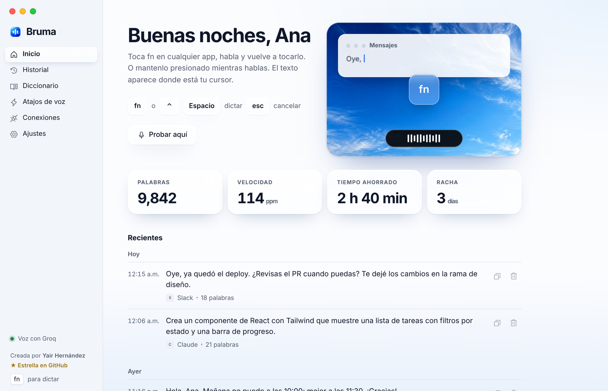
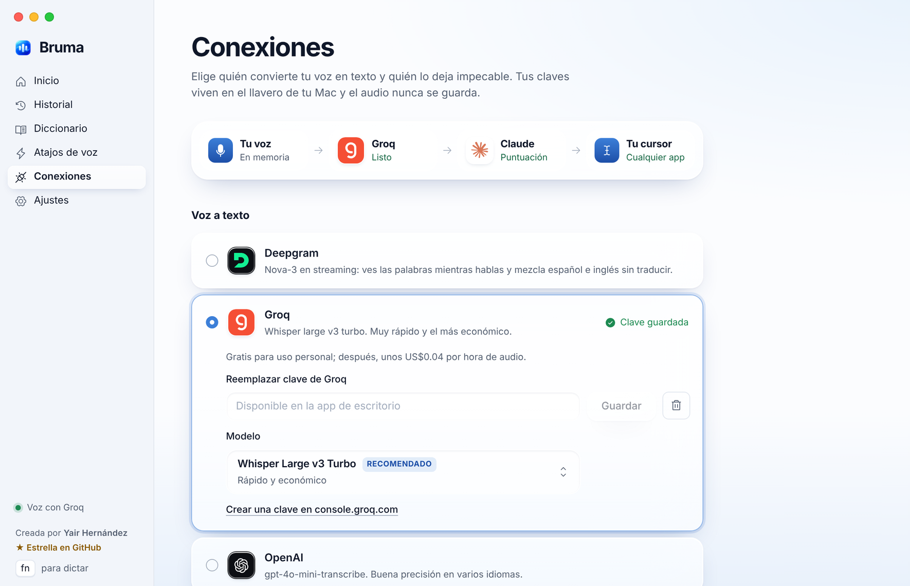
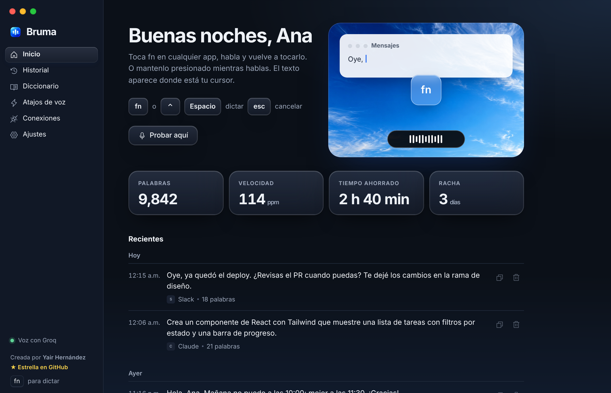
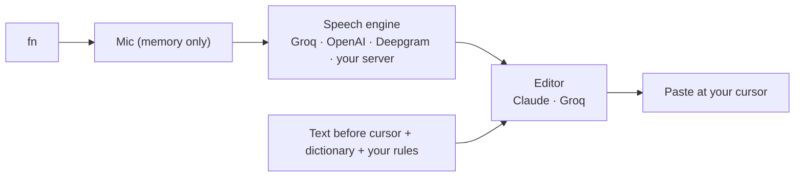

<div align="center">


# Bruma

**Talk. Bruma types.**

Free, open-source voice keyboard for your Mac. Tap <kbd>fn</kbd>, speak, and clean, punctuated text appears wherever your cursor is: in any app.

<p>
  <a href="https://github.com/yairhdz24/bruma/releases/latest"></a>
  <a href="https://github.com/yairhdz24/bruma/releases"></a>
  <a href="https://github.com/yairhdz24/bruma/stargazers"></a>
  <a href="LICENSE"></a>
  <br />
  <a href="#download"></a>
  <a href="#download"></a>
  
  <a href="CONTRIBUTING.md"></a>
  <a href="https://github.com/yairhdz24/bruma/issues?q=is%3Aopen+label%3A%22good+first+issue%22"></a>
</p>

[**Download**](#download) · [Español](README.es.md) · [How it works](docs/ARCHITECTURE.md) · [Report a bug](https://github.com/yairhdz24/bruma/issues/new/choose)

<a href="https://github.com/yairhdz24/bruma/stargazers"></a>

**If Bruma saves you time, please give it a ⭐. It's free, takes one second, and it's how other people find it.**


</div>



## Why Bruma

- **Free for personal use.** Bring your own key. With Groq's free tier you can dictate for hours a day without paying anything. No subscription, no account, no Bruma server.
- **Private by design.** Your audio stays in memory and goes straight from your Mac to the engine *you* choose. Keys live only on your computer.
- **Feels native.** A tiny pill above the Dock that wears the color of the app you're writing into, liquid-glass windows, San Francisco type, and real macOS traffic lights.
- **Writes like you.** Removes "um" and false starts, applies self-corrections ("Tuesday, no, Friday" → "Friday"), punctuates Spanish properly (¿? ¡!), keeps English words in English, and adapts to the app: short in WhatsApp, paragraphs in Mail, exact in your code editor.

## Features

| | |
| --- | --- |
| 🎙️ **fn to talk** | Tap <kbd>fn</kbd> to start and again to paste, or hold it and let go. Also fn + Space or any shortcut. <kbd>Esc</kbd> cancels anywhere. |
| ⚡ **Live words** | With Deepgram Nova-3, words fade in above the pill while you speak. |
| 🧠 **Context-aware** | Reads the few words before your cursor to get spaces and capitals right (never password fields). |
| 📚 **Learns your words** | Fix a word after Bruma pastes and the pill offers to add it to your dictionary. |
| ✍️ **Your rules** | Standing instructions in plain language: "always informal", "sign emails as Ana", "no emojis". |
| 🗣️ **Voice shortcuts** | Say "my email" and your address is typed. |
| 🌎 **Mixed languages** | Speak Spanish and English in the same sentence; nothing gets translated unless you ask. |
| 🔌 **Any engine, any model** | Groq, OpenAI, Deepgram or your own Whisper server, with every model each service offers. Claude or Groq to polish. |
| 📈 **Your stats** | Words, words per minute, time saved and streak, all local. |

<table>
<tr>
<td></td>
<td></td>
</tr>
</table>

## Download

| | |
| --- | --- |
| 🍎 **macOS** · Apple Silicon (M1–M4), macOS 12+ | [**Download Bruma for Mac (.dmg)**](https://github.com/yairhdz24/bruma/releases/latest/download/Bruma-macOS-Apple-Silicon.dmg) |
| 🪟 **Windows** 10/11 · 64-bit (beta) | [**Download Bruma for Windows (.exe)**](https://github.com/yairhdz24/bruma/releases/latest/download/Bruma-Windows-x64-setup.exe) |

All versions and release notes: [Releases](https://github.com/yairhdz24/bruma/releases).

### Install on macOS

1. Open the `.dmg` and drag **Bruma** into **Applications**.
2. Bruma isn't notarized by Apple yet, so the first time **right-click Bruma → Open → Open**. (Or run `xattr -dr com.apple.quarantine /Applications/Bruma.app` in Terminal.)
3. The welcome tour asks for **Microphone** (to hear you) and **Accessibility** (to paste text and read the fn key). Turn Bruma on in each list.
4. In **System Settings → Keyboard**, set **"Press 🌐 key to" → "Do Nothing"**, so fn is free for Bruma.

<details>
<summary><b>Prefer Terminal? One line that also keeps your permissions across updates</b></summary>

```sh
curl -fsSL https://raw.githubusercontent.com/yairhdz24/bruma/main/scripts/install-mac.sh | zsh
```

It downloads the latest release and signs it with a certificate created on your own Mac, so macOS remembers the Microphone and Accessibility permissions every time you update. Run it again to update.
</details>

### Install on Windows

1. Run `Bruma-Windows-x64-setup.exe`. If SmartScreen appears, click **More info → Run anyway** (the app isn't code-signed yet).
2. Allow microphone access if Windows asks (**Settings → Privacy → Microphone**).
3. Use a shortcut such as <kbd>Ctrl</kbd>+<kbd>Space</kbd> to dictate (the fn key is macOS-only).

## Get your free API key

Bruma doesn't have a server, so it uses **your own key**. The keys never leave your computer. You only need **one** to start: Groq is free.

### Groq: free (recommended)

1. Go to **[console.groq.com](https://console.groq.com)** and sign in with Google, GitHub or email. No credit card.
2. In the menu, open **API Keys** → **Create API Key**. Name it `Bruma`.
3. Copy the key (it starts with `gsk_`). It's shown only once.
4. In Bruma: **Conexiones → Groq → paste the key → Guardar**. Done, you can dictate.

With the same key Bruma can also polish your text for free (Conexiones → Pulir el texto → Groq).

### Optional keys

| Service | What it adds | Where to get it | Cost |
| --- | --- | --- | --- |
| **Claude** (Anthropic) | The best writing and punctuation | [console.anthropic.com → Settings → API Keys](https://console.anthropic.com/settings/keys) (starts with `sk-ant-`) | Pay as you go; needs credits in Billing |
| **Deepgram** | Words appear live while you speak | [console.deepgram.com](https://console.deepgram.com) → API Keys → Create | US$200 free credit to start |
| **OpenAI** | GPT-4o Transcribe models | [platform.openai.com/api-keys](https://platform.openai.com/api-keys) (starts with `sk-`) | Pay as you go |
| **Your own server** | 100% yours, no third party | Any OpenAI-compatible Whisper, e.g. [Speaches](https://github.com/speaches-ai/speaches) | Your hardware |

Paste each key in **Conexiones**, pick the model you want from the list, and you're set.

## How to use it

| Action | macOS | Windows |
| --- | --- | --- |
| Start / stop and paste | Tap <kbd>fn</kbd> | <kbd>Ctrl</kbd>+<kbd>Space</kbd> (configurable) |
| Push-to-talk | Hold <kbd>fn</kbd>, speak, let go | — |
| Alternative key | <kbd>fn</kbd>+<kbd>Space</kbd> or any shortcut (Ajustes → Atajo) | Any shortcut |
| Cancel | <kbd>Esc</kbd> | <kbd>Esc</kbd> |

- **Put the cursor where you want the text**, in any app: WhatsApp, Slack, Mail, Notes, Claude, ChatGPT, your code editor.
- **The pill above the Dock** shows what's happening. It turns the color of the app you're writing into while it listens, shows dots while it writes, and a check when it pastes. Hover it while listening to cancel or finish with the mouse.
- **Speak naturally.** Say "new line", "comma" or "question mark" if you want. Correct yourself out loud ("at five, no, at six") and Bruma keeps the correction.
- **Dictionary:** add names and terms you want spelled right (Supabase, your company, people). If you fix a word right after Bruma pastes, it offers to add it for you.
- **Voice shortcuts:** say "my email" and your address is typed.
- **Your rules:** in **Ajustes → Tus reglas**, write standing instructions such as "always informal" or "no emojis".
- **History:** everything you dictated, with the app it went to, to copy again. Local, and you can turn it off.

## How it works



Bruma is a [Tauri 2](https://tauri.app) app: a React + TypeScript interface on top of a Rust core, plus a few small Objective-C helpers for the fn key, pasting and Accessibility. Details in [docs/ARCHITECTURE.md](docs/ARCHITECTURE.md).

## What it costs

| Engine | Price | Notes |
| --- | --- | --- |
| **Groq** Whisper Large v3 Turbo | **Free tier**, ~8 h of audio per day | Default. Very fast. |
| **Groq** to polish | **Free tier** | GPT-OSS 120B, falls back to Llama 3.3. |
| Claude Haiku to polish | Fractions of a cent per dictation | Best writing. Uses your Anthropic API credits. |
| Deepgram Nova-3 | US$200 starting credit, then ~US$0.46/h | Live words while you speak. |
| OpenAI | Pay as you go | GPT-4o Transcribe models. |
| Your own server | Your hardware | Any OpenAI-compatible Whisper, e.g. [Speaches](https://github.com/speaches-ai/speaches). |

Prices are set by each provider and can change; check their sites.

## Privacy & security

- **No Bruma server, no telemetry, no account.**
- **Keys never leave your computer.** macOS: a private file readable only by your user (`credentials.json`, mode 0600). Windows: Credential Manager. The interface never sees them.
- **Audio is never saved.** It's held in memory and sent only to the engine you picked.
- **History is local** and can be turned off or cleared.
- **Never sends for you.** Bruma pastes; it never presses Enter. Your clipboard is restored afterwards.

See [SECURITY.md](SECURITY.md) to report a vulnerability privately.

## Build from source

```sh
git clone https://github.com/yairhdz24/bruma && cd bruma
npm ci
npm run dev          # interface preview in the browser (demo mode)
npm run tauri dev    # full desktop app (needs Rust + Tauri prerequisites)
npm test             # Playwright
cd src-tauri && cargo test
```

## Roadmap

- [ ] Edit by voice: select text and say "make it formal" or "translate to English".
- [ ] Prompt mode: turn rambling speech into a well-structured prompt for AI apps.
- [ ] Live words with free engines (chunked Whisper).
- [ ] Local Whisper (WhisperKit / whisper.cpp) for offline dictation.
- [ ] Notarized macOS builds and an Intel build.

Ideas and pull requests are welcome; start with [CONTRIBUTING.md](CONTRIBUTING.md).

## Contributing

Bruma is built in the open and contributions are very welcome, from typo fixes to new engines.

1. Pick an issue labeled [**good first issue**](https://github.com/yairhdz24/bruma/issues?q=is%3Aopen+label%3A%22good+first+issue%22) or [**help wanted**](https://github.com/yairhdz24/bruma/issues?q=is%3Aopen+label%3A%22help+wanted%22), or [propose an idea](https://github.com/yairhdz24/bruma/discussions).
2. Fork, run `npm ci && npm run dev`, and make your change. CI builds the macOS and Windows apps for every pull request, so you don't need Xcode to work on the interface.
3. Open a pull request. The full guide is in [CONTRIBUTING.md](CONTRIBUTING.md).

<a href="https://github.com/yairhdz24/bruma/graphs/contributors"></a>

## Support Bruma

Bruma is free and built in the open. The best ways to help:

- ⭐ **[Star the repo](https://github.com/yairhdz24/bruma/stargazers)**: it's the #1 way people discover it.
- 🐛 **[Report a bug or ask for a feature](https://github.com/yairhdz24/bruma/issues/new/choose).**
- 🔁 **Share it** with a friend who types a lot, or post a clip of the pill in action.
- 🛠️ **Contribute**: see [CONTRIBUTING.md](CONTRIBUTING.md).

## Star history

[](https://star-history.com/#yairhdz24/bruma&Date)

## Credits

Created by **[Yair Hernández](https://github.com/yairhdz24)**. Service logos from [svgl](https://svgl.app) belong to their owners; see [docs/brand-assets.md](docs/brand-assets.md).

Released under the [MIT License](LICENSE).
