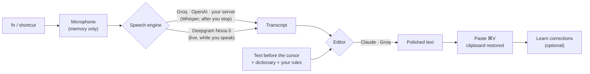

# How Bruma works

1. **Trigger.** A native event tap (`native/keys.m`, `fn_key.rs`) watches the fn key: tap to toggle, hold to talk, or fn + Space. A regular global shortcut works everywhere, including Windows.
2. **Capture.** `audio.rs` opens the microphone the moment you press the key and buffers in memory, so the first word is never lost. It keeps listening ~0.4 s after you stop so the last word isn't cut.
3. **Context.** `platform.rs` finds the app you are writing into (name, bundle, real icon) and, through Accessibility (`native/focus.m`), the few characters before the cursor. Password fields are never read.
4. **Speech → text.** `providers.rs` sends 16 kHz WAV to an OpenAI-compatible `/audio/transcriptions` endpoint (Groq, OpenAI or your own Whisper server), or streams PCM to Deepgram over WebSocket. Spanish and English are detected per recording, so mixed speech is never translated.
5. **Editing.** A short system prompt turns the transcript into clean text: punctuation, ¿? and ¡!, self-corrections ("el martes, no, el viernes"), lists, misheard tech words, the style of the destination app and your personal rules. Dictations of three words or less skip this step.
6. **Delivery.** `native/paste.m` puts the text on the pasteboard (marked transient/concealed for clipboard managers), presses ⌘V and restores your previous clipboard.
7. **Learning.** `learn.rs` watches the field for a few seconds; if you fix one word, the pill offers to add it to your dictionary.

## Layout

| Path | What lives there |
| --- | --- |
| `src/` | React interface: home, history, dictionary, voice shortcuts, connections, settings, welcome tour, floating pill (`DictationPill.tsx`). |
| `src/lib/` | Bridge to Rust, types, hooks, brand color of the destination app (`appColor.ts`). |
| `src-tauri/src/dictation.rs` | The dictation session: start, record, stop, deliver. |
| `src-tauri/src/providers.rs` | Speech engines, editors, prompts and local key storage. |
| `src-tauri/src/models.rs` | Lists every model each provider offers, for the pickers. |
| `src-tauri/src/pill.rs` | The always-on-top pill window and its click-through hitbox. |
| `src-tauri/src/history.rs` | Local history and stats. |
| `src-tauri/native/` | Small Objective-C helpers for AppKit and Accessibility. |

## Building

CI (`.github/workflows/desktop.yml`) builds the macOS (Apple Silicon) and Windows apps on every push and publishes them as a GitHub Release when a `v*` tag is pushed.
